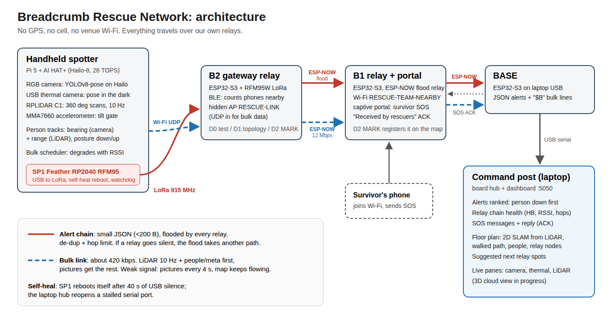
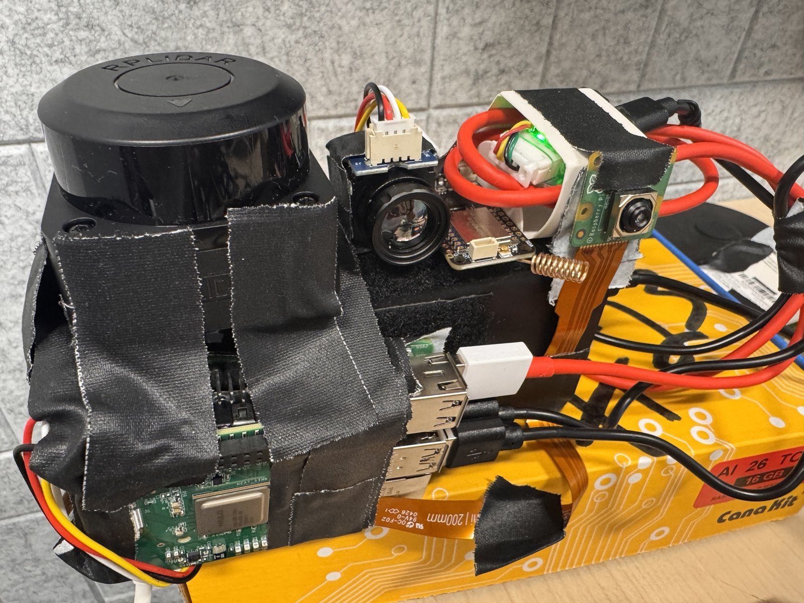
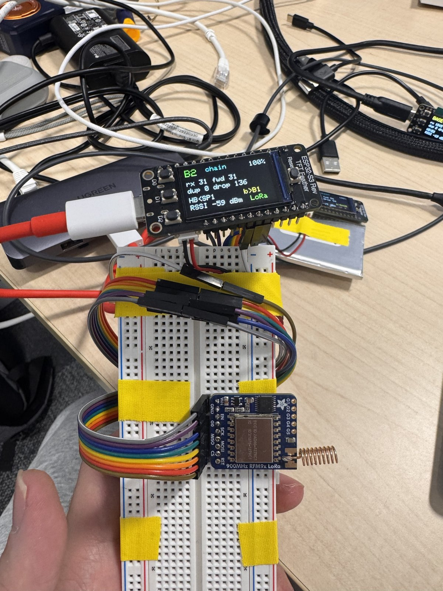
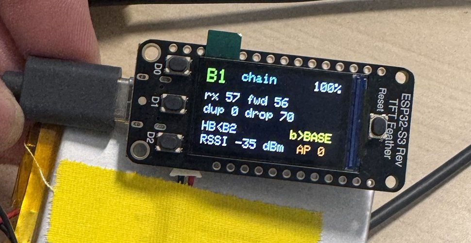
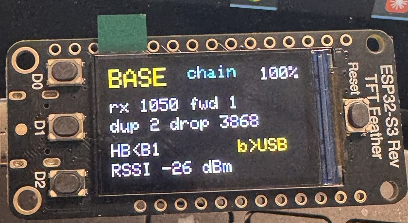

# Breadcrumb Rescue Network

**Team 23, Code Metal Forge Hackathon 2026 ("Operation Lost and Found").** Boston, Nov 6-8, 2026.

A responder walks into a building that has no GPS, cell service or Wi-Fi. They carry a handheld spotter: a Raspberry Pi 5 with an AI accelerator, an RGB camera, a thermal camera and a 2D LiDAR. As they go, they drop small radio relays ("breadcrumbs"). The spotter finds people, in the dark too, and works out where they are. It also draws a floor plan of the building. Everything it learns goes back to a command-post laptop over the team's own relay chain, with no outside network.

- **Alerts** ("person found", "SOS") travel over LoRa and an ESP-NOW flood mesh. Every relay forwards them, so the chain heals itself when one relay goes quiet.
- **Bulk data** (camera, thermal, LiDAR scans, people positions) travels over a separate fast link through the same relays. When the radio signal gets weak, it sheds the pictures first.
- **Survivors with a phone** can join the `RESCUE-TEAM-NEARBY` Wi-Fi on a relay and send an SOS from a captive-portal page. They see "Received by rescuers" when the command post acknowledges it.



## How it maps to the challenge

| Objective | What we built |
|---|---|
| OBJ.01 Locate isolated people | Each detected person gets a bearing (from the camera) and a range (from the LiDAR). The spotter's SLAM pose turns these into a point on the floor plan. Phones near a relay are counted over BLE. The captive portal gives survivors a way to report in. |
| OBJ.02 Detect life and hazards | YOLOv8-pose on the Hailo-8 runs on the RGB camera and also on the thermal camera, so it still finds people in low light. Posture tells lying apart from upright, and the dashboard ranks a person on the ground first. Survivors can report hazards through the SOS form. |
| OBJ.03 Map changing conditions | The handheld LiDAR runs 2D SLAM, with an accelerometer to reject scans taken while the rig is tilted. The command post shows a live floor plan with the walked path, the people and the relay positions. |
| OBJ.04 Deliver critical information | There are two links. LoRa plus the ESP-NOW flood mesh carries small alerts and needs no infrastructure. The bulk link (about 420 kbps) adapts to signal quality. The map suggests where to drop the next relay. |

## Mentor feedback we designed for

1. **Low light.** Pose detection also runs on the thermal camera. A thermal-only detection still raises a PERSON alert, marked `s:"T"`.
2. **Environment modelling.** The handheld 2D SLAM builds a floor plan on the dashboard, drawn as clean wall segments. A 3D point cloud view is also available, with floor and ceiling returns hidden by default. (We tried nodding the rig to add height and dropped it: it distorts the cloud too much.)
3. **Node-failure resilience.** Alerts flood through every relay with de-duplication and a hop limit, so they route around a relay that goes silent. The spotter's LoRa bridge (SP1) reboots itself when its USB link stalls, and a hardware watchdog backs that up. The laptop hub reopens a serial port that goes silent. A relay can be switched off by holding its D1 button for 1 s to show the chain healing (about 8 s), and a relay restarts itself if its radio or main loop stalls, and every relay reports its battery level. On a weak signal the operator can switch the spotter to LoRa only: alerts keep coming, pictures and the map pause (verified).
4. **Best relay placement.** The planner estimates link margin from the walked path, the distance and the walls on the map. It suggests where the next relay should go, labelled "place relay N" on the map. Operators register a real relay by pressing its D2 button while standing next to it, or by dragging it on the map. The relay in hand also watches its own link back to the chain and, when the signal falls below -70 dBm, shows DROP HERE on its screen, beeps the spotter's speaker and puts a banner on the dashboard (bench-verified).

## Status (what is verified on hardware)

| Capability | Status |
|---|---|
| LoRa SP1 → B2 → ESP-NOW B1 → BASE alert chain, under 1 s end to end | verified 2026-11-07 |
| Captive-portal SOS from an iPhone, with an ACK back to the phone | verified 2026-11-07 |
| Alert flood healing around a silent relay | verified 2026-11-07 |
| Relay off/on by holding its D1 button for 1 s (ignored on B2, which the spotter needs), or from the dashboard (`POST /api/cmd {"to":"B1","c":"off"}`): the relay sends nothing, not even beacons, its screen shows a large red RELAY OFF, and the chain heals around it in about 8 s | verified 2026-11-08 08:25 EST (B1 off: B2's messages went straight to BASE; B1 re-joined 2 s after it was switched back on); 1 s hold verified 10:30 EST on firmware 6352e7b (3 off/on cycles on B1, ignored on B2) |
| Relay self-restart: a relay restarts itself (about 3 s) if its radio completes no ESP-NOW send for 30 s (was 15 s) or its main loop stops for 10 s; its placed state, LoRa-only mode and placement threshold survive the restart | verified 2026-11-08 on firmware 6352e7b (flashed 10:30 EST): no false restart in a 10 min soak (an earlier false trigger at 10:12 was fixed). An ESP-NOW init failure now restarts the board instead of halting |
| B2 no longer resets after D2: RadioHead's LoRa interrupt handler used the SPI bus shared with the screen, which tripped the interrupt watchdog; LoRa is now polled from the main loop | verified 2026-11-08 10:51 EST (11 D2 presses on B2, 0 drops; no B2 reboot from 10:30 on) |
| SP1 USB self-heal (reboot after 40 s of silence) and hub serial reopen | verified 2026-11-07/08 |
| YOLOv8-pose on Hailo-8 (RGB) and on the USB thermal camera | verified 2026-11-07 |
| Bulk link Pi → B2 → B1 → BASE (about 420 kbps), with camera, thermal and LiDAR panes on the dashboard | verified 2026-11-08 |
| Auto-degrade of the bulk link on weak Wi-Fi signal | implemented, unit-tested (`tests/test_bulklink.py`) |
| Person-down alert latency: 1.73 s from the start of the fall to the dashboard card (0.73 s from the first "down" frame, of which 0.59 s is transport) | measured 2026-11-08 06:15 EST |
| Node button D2 MARK registers B1 / B2 / BASE at the spotter's SLAM pose | verified 2026-11-08 06:17 EST (MARK from B1 and B2 arrived and placed) |
| "Pause map" while the rig is set down; mapping resumes at the same pose | implemented, unit-tested (`tests/test_mapping_slam.py`) |
| Bulk-link status shows LINK DOWN after 5 s without spotter data | implemented |
| Pi Wi-Fi watchdog re-joins RESCUE-LINK after B2 reboots | verified 2026-11-08 10:59 EST (B2 hard reset, bulk data flowing again 12 s later; it used to take 30 s to 4 min); unit-tested (`tests/test_linkwatch.py`) |
| Battery level of every relay: MAX17048 fuel gauge on each Feather, charge (%) and voltage in each heartbeat, shown in the dashboard relay chain and in the corner of the relay screen | verified 2026-11-08 08:20 EST (B1 and BASE) |
| LoRa-only mode for a weak signal: a dashboard button sends a command down the chain to B2, which drops the Pi's bulk link. Alerts keep arriving over LoRa; pictures, the map and positions pause | verified 2026-11-08 08:33 EST (B2 confirmed in 0.6 s and the bulk link stopped; a PERSON alert still arrived over LoRa; pictures were back within 12 s of restoring) |
| Handheld 2D SLAM floor plan with walked path and people on the map | verified 2026-11-08 05:46-05:53 EST (walk3, live over the bulk link: about 43 m walked, ends 0.46 m from the start, 2628 of 3044 scans accepted, 34 wall segments, 3 people placed by bearing and range) |
| Walked path coloured by measured Wi-Fi signal to B2 (good at -67 dBm and above, fair down to -77, poor below) | implemented, deployed 2026-11-08 06:27 EST |
| Fewer false PERSON alerts: no re-alert for a re-found person (within 15° / 60 s); "down" needs a visible torso, no box under 1.0 m, and thermal confirmation while the thermal camera runs; LiDAR range cross-checked against box-size range and not used when the rig tilts more than 10° | implemented, unit-tested (`tests/test_locate_track.py`) |
| One map dot per person: a new tracker id takes over the nearby old entry; with a tilted rig the last level range is kept, and a first sighting is placed and flagged "range unsure" | implemented, unit-tested (`tests/test_mapview_tilt.py`) |
| Dashboard draws a person first seen while the rig was tilted with a dashed outline and "range unsure" | implemented |
| Phones near a relay (BLE halo) and SOS pins drawn at the marked relays on the floor plan: a zone, not a position | implemented; the B2 BLE scan is off by default in the demo build (coexistence with the gateway radio: B2 restarted 4 times at 11:25-11:29 EST while scanning about 55 phones; build with `-DHAS_BLE=1` to re-enable) |
| SOS card says "about N m from B1", from the phone's Wi-Fi signal at B1 (d = 10^((-40 - RSSI)/25) m, a rough model, ±6 dB band drawn on the plan) | implemented, B1 flashed 2026-11-08; live test with an iPhone pending |
| SOS phone search area: only after an SOS (no listening otherwise, to save airtime and CPU), B1 reports the phone's MAC tail and its own RSSI; B2 and BASE listen 5 s for that phone's Wi-Fi frames and reply. The dashboard draws a 1/d²-weighted centre of the relays that heard it (so it always lies among them), with the same distance model as the SOS band. Repeated SOS from the same phone are averaged and the radius shrinks by √k, to 3 m at least. A search area, not a fix | listening and readings verified 2026-11-08 08:40 EST with an iPhone (B1 took the SOS at -57 dBm; B2 heard 143 frames, mean -68 dBm; BASE 162 frames, -62 dBm; all three readings reached the dashboard and matched the SOS card). Area method (dashboard 14a2fb6) checked on the 08:49 live data: centre 0.6 m from B2, where the earlier fit put it 8 m beyond B2. Not yet tested with relays marked at different spots |
| Room-style plan: wall segments extracted from the SLAM grid (denoised, about 70 ms) | implemented, unit-tested (`tests/test_floorplan.py`) |
| Suggested relay spots on the floor plan, labelled "place relay N" | implemented; calibrating the radio model from measured RSSI along the walk is in progress |
| Relay placement prompt: the relay in hand watches its link to the strongest live node behind it (so switching off one relay does not trigger it). When the average beacon RSSI stays below -70 dBm for 3 beacons, it shows DROP HERE on its own screen, the Pi plays a distinct beep pattern from the Pi's GPIO speaker, and the dashboard shows a banner, repeated every 15 s until D2 is pressed. -70 dBm leaves about 15 dB of margin over the roughly -85 dBm the 12 Mbps bulk link needs, without wasting range by dropping relays too close | bench-verified 2026-11-08 08:36 EST (threshold raised for the test: B1 sent PLACE, B2 passed it to the Pi, the dashboard showed the card); not yet tested on a real walk |
| 3D point cloud view, with estimated floor and ceiling returns hidden by default (Floor/ceiling toggle) | implemented, unit-tested (`tests/test_cloud_filter.py`, `tests/test_cloud_filter_replay.py`) |
| Nodding the rig while the map is paused, to add height to the 3D cloud | dropped 2026-11-08 about 07:00 EST: it distorts the point cloud too much. Only the guard that drops scans tilted past 30° remains |

## Hardware

| Role | Hardware |
|---|---|
| Spotter (handheld) | Raspberry Pi 5 16 GB with the Raspberry Pi AI HAT+ (Hailo-8, 26 TOPS); Camera Module 3 (IMX708); USB thermal camera (640x512, UVC); Slamtec RPLIDAR C1 (USB, CP2102N); Grove MMA7660 accelerometer (I2C); official Pi PSU or a 27 W USB-C PD power bank (weaker banks rebooted the Pi) |
| SP1, the spotter's LoRa bridge | Adafruit Feather RP2040 RFM95 (#5714), 915 MHz, 5 dBm, on the Pi's USB |
| B2, gateway relay | Adafruit Feather ESP32-S3 Reverse TFT (#5691) with an RFM95W LoRa breakout (#3072). It receives LoRa, listens for BLE phones (off by default in the demo build), and runs the hidden `RESCUE-LINK` AP that the Pi uses for bulk data. |
| B1, relay and survivor portal | Feather ESP32-S3 Reverse TFT. It runs the `RESCUE-TEAM-NEARBY` captive portal. |
| BASE, command post | Feather ESP32-S3 Reverse TFT on USB to the laptop |
| Command post | Any laptop with Python 3, running the dashboard at http://localhost:5050 |

## Photos from the build (Nov 8)

### The spotter rig



The handheld spotter, taped onto the Pi kit box so one person can carry it. The RPLIDAR C1 sits on top at the left and scans the room for the map. In the middle is the USB thermal camera lens, with the Grove accelerometer above it; the accelerometer tells the map when the rig is tilted. Behind them is SP1, the Feather RP2040 LoRa board with its spring antenna, which sends alerts to the relays even when Wi-Fi is down. On the right is the Pi Camera Module 3, the main camera for person detection. Under the tape is the Raspberry Pi 5 with the AI HAT+, which runs YOLOv8s-pose on the Hailo-8. The whole rig runs from one USB power bank with no cable to the laptop.

### Relay B2, the gateway



B2 is the relay closest to the spotter. The ESP32-S3 Reverse TFT Feather is wired over SPI to a 900 MHz RFM9x LoRa breakout on the breadboard, so B2 can hear SP1's LoRa packets. It also runs the hidden `RESCUE-LINK` Wi-Fi network that the Pi uses for camera frames and LiDAR scans. The screen shows `HB<SP1`, the last packet was a heartbeat from the spotter; `b>B1`, bulk data goes next to B1; and a green `LoRa`, the radio is up.

### Relay B1 on a LiPo battery



B1 is the middle relay and runs from its own LiPo battery, so it can be dropped anywhere along the route. It also hosts the `RESCUE-TEAM-NEARBY` portal, where a trapped person's phone can send an SOS. `HB<B2` means it is hearing B2, `b>BASE` means bulk data goes on to BASE, and `AP 0` means no phone is on the portal right now.

### BASE at the command post



BASE is the last node, plugged into the laptop by USB (`b>USB`). Everything it receives goes to the dashboard. `HB<B1` at -26 dBm shows that B1 is close by in this test.

### How to read a relay screen

Every node shows the same status lines:

| Field | Meaning |
|---|---|
| `B1`, `B2`, `BASE` | Node name |
| `chain` | Routing mode: messages hop along the chain SP1 > B2 > B1 > BASE |
| `100%` | Battery level |
| `rx N fwd N` | Packets received, and packets passed on to the next node |
| `dup N drop N` | Duplicates ignored (the same alert heard twice), and packets not forwarded (frames that are not alerts, or a full queue). `drop` is not a loss rate. |
| `HB<B2` | Type and sender of the last packet (`HB` is a heartbeat) |
| `RSSI -35 dBm` | Signal strength of that packet. Closer to 0 is stronger. |
| `b>BASE` (yellow) | Next hop for bulk data (camera frames, LiDAR) |
| `AP 0` | Phones on the SOS portal (B1 only) |
| `LoRa` / `noLR` | LoRa radio up (green) or missing (red) (B2 only) |

## Repository layout

```
rescue-net/            Python: spotter (Pi), command-post dashboard (laptop), mapping, tests
  spotter/             detection (Hailo YOLOv8-pose), thermal, LiDAR, IMU, tracking, LoRa sink, bulk link
  dashboard/           Flask command post: alerts, relay chain, floor plan, live panes
  mapping/             2D SLAM (numpy only), relay planner, offline replay
  common/              wire protocol, serial helpers, JSON logs
  tests/               pytest suite (runs without hardware)
firmware/
  lora_bridge/         SP1: USB JSON → LoRa (Feather RP2040 RFM95)
  breadcrumb_espnow/   B2 / B1 / BASE: ESP-NOW flood relay, LoRa gateway, BLE, captive portal, bulk link
tools/                 laptop board hub (serial ↔ HTTP, starts the dashboard), walk recorder
docs/                  architecture diagram, demo script, write-up
notes/, photos/        build log and photos from the weekend
```

## Setup and running the demo

Details are in [rescue-net/README.md](rescue-net/README.md). In short:

1. **Flash the boards** with the Arduino IDE or `arduino-cli`, using the ESP32 core and the libraries ArduinoJson, RadioHead and Adafruit ST7789/GFX.
   - SP1: `firmware/lora_bridge/lora_bridge.ino`, built for the Feather RP2040 RFM95.
   - B2, B1 and BASE: `firmware/breadcrumb_espnow/breadcrumb_espnow.ino`, built with `-DNODE_ID=\"B2\"`, `\"B1\"` or `\"BASE\"`.
2. **Set up the Pi:**
   ```
   cd rescue-net
   python3 -m venv --system-site-packages .venv
   .venv/bin/pip install -r requirements.txt
   ```
   Then `python -m spotter.main --port /dev/serial/by-id/<SP1>`. In the demo it runs as the systemd service `rescue-spotter`. The Pi joins B2's hidden `RESCUE-LINK` AP for the bulk link.
3. **Start the command post** on the laptop:
   ```
   cd rescue-net
   pip install -r requirements.txt
   python -m dashboard.app --port <BASE serial port>
   ```
   Then open http://localhost:5050. In the demo, `tools/board_hub.py` owns the serial ports and starts the dashboard.
4. **No hardware?** Run `python -m dashboard.app --mock`, or replay a log with `--replay logs/messages-YYYYMMDD.jsonl`. `python -m mapping.replay <walk.jsonl.gz> out.png` builds a floor plan from a recorded walk.
5. **Tests:** `cd rescue-net && python -m pytest -q`.

## Known limits

- B2 is the spotter's only gateway: only B2 has the LoRa radio and the `RESCUE-LINK` AP, so if B2 fails the spotter is cut off, and B1 or BASE cannot take over.
- Power: the Pi rebooted several times on a weak supply, so the spotter needs the official Pi PSU or a 27 W USB-C PD power bank. To cut its load, detection runs at 5 fps and the camera at 10 fps, and Bluetooth is off: spotter CPU went from 64% to 40%, Pi power from 3.5 W to 3.1 W, temperature from 58.9 to 56.7 °C, with no under-voltage.
- The moving spotter cannot listen for an SOS phone: the Pi 5's onboard Wi-Fi has no monitor mode. Phones are not tracked over BLE either: about 50 phones were nearby at the venue, and a phone's BLE address is unrelated to its Wi-Fi one.
- More limits of the spotter and the map are in [rescue-net/README.md](rescue-net/README.md#known-limits).

## Next steps

- LoRa on every relay, and a spotter that falls back to any relay it can reach, so B2 is no longer a single point of failure.
- An ESP32 on the spotter that listens for the SOS phone while walking, so one phone is measured from many known positions, not only from the fixed relays. See [docs/writeup.md](docs/writeup.md).

## Team

- Xiaofan Liu (UMass Amherst): radio firmware, bulk link, command post, mapping integration
- Shivansh Chhawri (UMass Amherst): spotter (on-device detection), original system plan, first dashboard
- Danica Catoni (remote): breadcrumb relay concept and roadmap
- Ziwen Xie (UMass Amherst, remote support)

Xiaofan also used AI coding assistants (Claude Code, Codex) throughout the build.

## Credits

All code here was written during the event. Shivansh's original spotter and dashboard are imported unmodified at commit `04ff889`, tagged `shivansh-original`; later commits build on them.

We used these existing libraries and models:

- Ultralytics YOLOv8-pose (AGPL-3.0), as the precompiled `yolov8s_pose_h8.hef` from the Hailo Model Zoo, run with HailoRT through `picamera2.devices.Hailo`
- `picamera2` / libcamera, OpenCV, NumPy, Flask, pyserial, smbus2
- Slamtec RPLIDAR C1 serial protocol
- Arduino-ESP32 / ESP-IDF (ESP-NOW, WiFi, BLE), ArduinoJson, RadioHead (RH_RF95), Adafruit GFX and ST7789

## License

Apache License 2.0 (see `LICENSE`).
